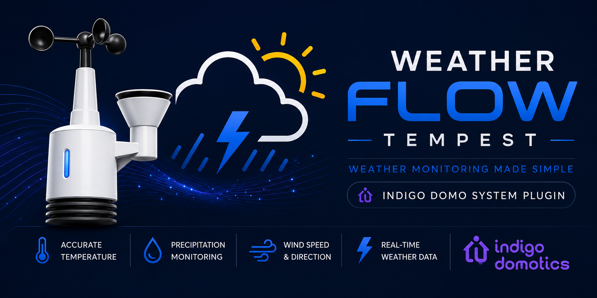

# Release 2.6.3

**Released:** 2026-10-31
**Minimum Indigo version:** 2025.2

← [Back to Changelog](https://github.com/Ghawken/WeatherFlowTempest/wiki/Changelog)


## Highlights

Responds to a **WeatherFlow server-side access policy change** (October 2026) that broke all Public Tempest Station devices:

- The shared/anonymous API key the plugin used for public stations has been **revoked by WeatherFlow** (HTTP 401)
- Personal API tokens are now **scoped to stations owned by — or shared with — your account**; anyone else's station returns HTTP 404
- Third-party public station data now requires **Enterprise-level access** from WeatherFlow

The plugin now authenticates public-station polling with your personal API token, so **your own stations (accessed remotely) and stations shared with your account continue to work**. Stations belonging to others cannot be recovered by the plugin.


## Changes

### Public station polling now uses your personal API token

`_fetch_public_station_obs` prefers the personal API token from Plugin Config, falling back to the (now revoked) shared key only when no token is set.

**What this means in practice:**

| Station | Result |
|---|---|
| Your own station (e.g. accessed from a different network) | ✅ Works — token required in Plugin Config |
| A station explicitly shared with your WeatherFlow account | ✅ Works |
| Anyone else's public station | ❌ HTTP 404 — WeatherFlow Enterprise access required |

If you don't have a token: it's free — tempestwx.com → Settings → Data Authorizations → Create Token, then paste it into Plugin Config.

### Clear handling of the new failure modes

- **HTTP 404** (station not owned by / shared with your account): a single explanatory warning is logged and polling for that device is suspended immediately — no repeated cryptic errors:

```
Tempest Public Hornsby: station 39653 is not accessible (HTTP 404). WeatherFlow now
restricts API access to stations owned by — or shared with — your account; third-party
public stations require Enterprise access from WeatherFlow. If this is your own station,
make sure your personal API token is entered in Plugin Config. Polling suspended for
this device.
```

- **HTTP 401 with no token configured**: the warning now explains that anonymous access has been revoked and points to where to create a free token.


## Upgrade Notes

- **If you use Public Tempest Station devices for your own remote station:** make sure a personal API token is entered in Plugin Config — the device then keeps working as before.
- **If you monitor other people's stations:** those devices will suspend with the warning above. The only paths WeatherFlow offers are (a) ask the station owner to share the station with your WeatherFlow account, or (b) Enterprise access from WeatherFlow. You may want to delete those devices.
- The [Public Tempest Station wiki page](https://github.com/Ghawken/WeatherFlowTempest/wiki/Public-Tempest-Station) has been updated with a full notice.
- Personal (UDP/web) Tempest, Sky, and Air devices are completely unaffected.
